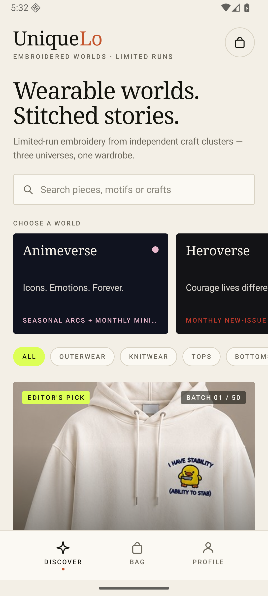
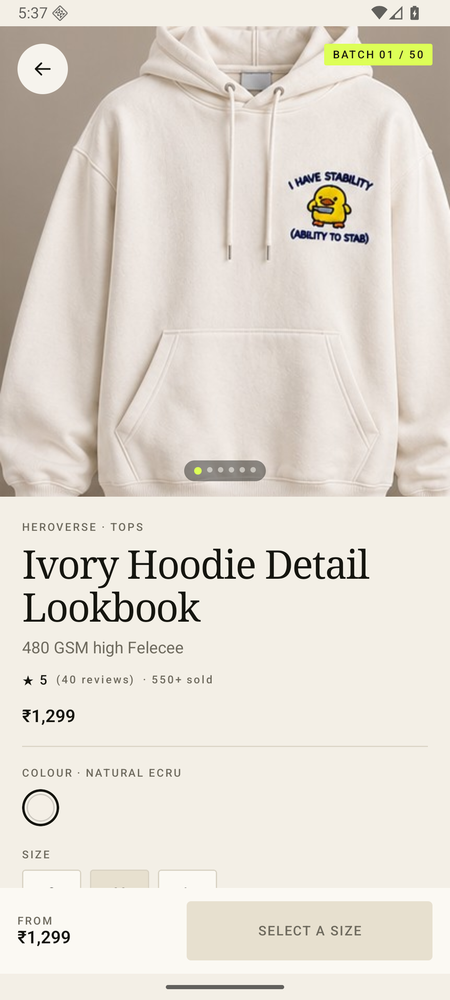
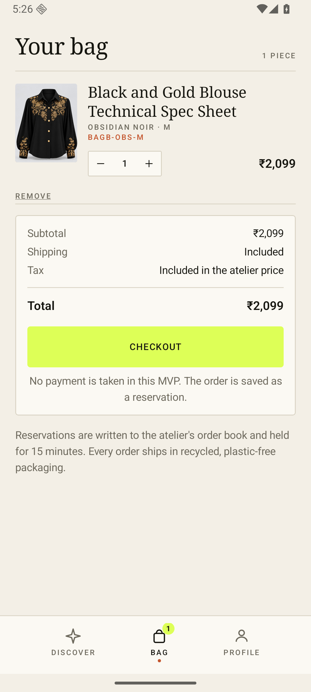
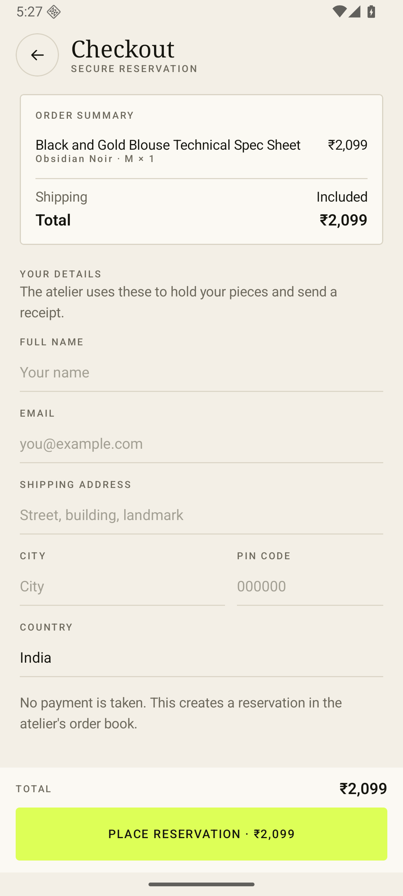
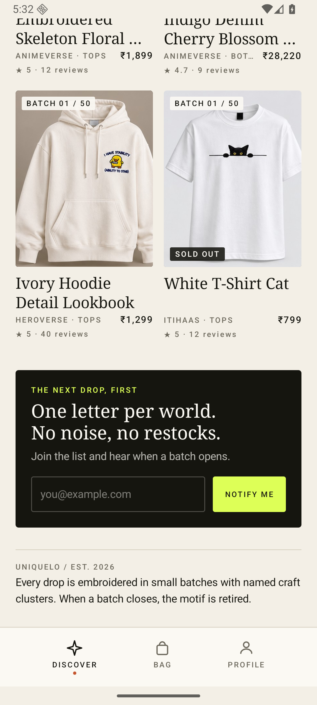
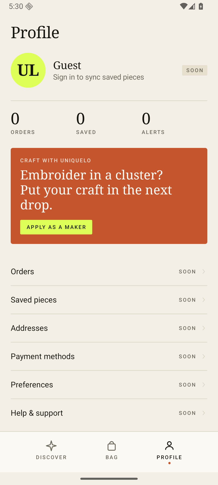
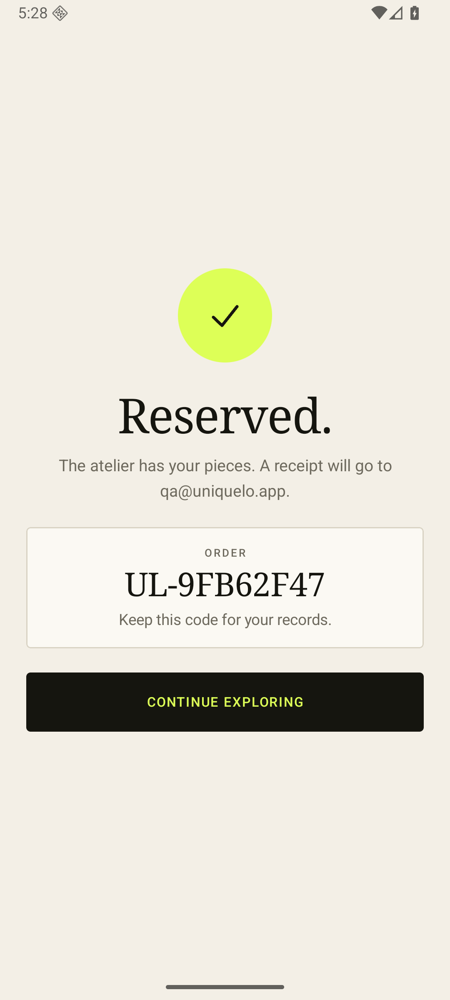
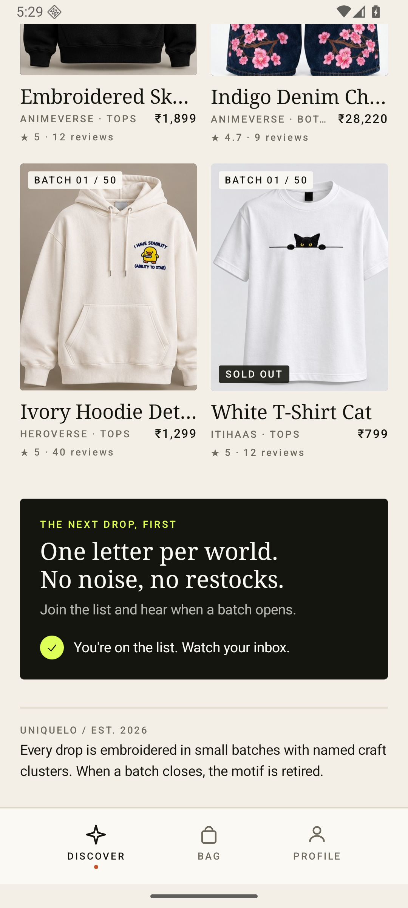

# UniqueLo

**Wearable worlds. Stitched stories.** UniqueLo is an Android-first Kotlin
Multiplatform storefront for limited-run embroidered apparel, built with Compose
Multiplatform and backed by a live Supabase project.

The project started as a structural rebuild of a decompiled Nike Android app
(feed → PDP → bag → profile). No Nike code, assets, copy or data are included.
The catalogue, imagery, craft stories and orders now come from the Supabase
schema described below.

## Project status (audited 2026-10-23)

Phase 1 (offline-first state, atomic order SQL), Phase 2 (typed navigation,
store split, DI, CI, catalogue lockdown SQL) and Phase 3 (Uniqlo-inspired
design system, dark theme, Satoshi typography, shared-element card→PDP,
accessibility pass) are code-complete and verified.

The backend is **shared with the web project** at
`/Users/apple/UniqueLo/backend`: its `schema.sql`, `migrations/` and seeds
are the schema source of truth (D-14). The mobile app owns no DDL. The contract
and current hosted drift are recorded in
[`PROJECT_STATE.md` § Backend contract](docs/PROJECT_STATE.md#backend-contract-shared-with-the-web-project).

Deployment state:

- **OA-1 closed** — `place_order` v2 and `get_order_details` are applied and
  live-verified on the hosted project; checkout uses the atomic RPC.
- **OA-2 / OA-5 closed (D-15)** — the authenticated-admin lockdown
  (`20260104000000_lockdown_auth_admin.sql`) is live: `anon` is read-only on all
  nine catalogue tables and storage uploads require `authenticated`. The earlier
  interim/no-auth drafts remain as replay history.
- **OA-6 open** — `authenticated` currently means *any* signed-in user, not a
  verified admin. Gate catalogue/storage policies by an admin claim before
  public sign-up ships. See [RLS warning](#rls-warning).

Evidence: [`phase-1-audit.md`](docs/phase-1-audit.md),
[`phase-2-audit.md`](docs/phase-2-audit.md). The shared source of truth is
[`PROJECT_STATE.md`](docs/PROJECT_STATE.md).

## What the MVP does

| Screen | Behaviour |
|---|---|
| **Discover** | Three universe cards with live theme colours, category chips, search across pieces/motifs/crafts, featured edit, two-column grid, newsletter signup |
| **Product** | Photo pager, universe + category, rating/review count, INR price, colour and size selection with live stock, craft story (technique, region, artisan hours, thread), materials/care/fit, customer reviews and unauthenticated/unmoderated review submission (D-20) |
| **Bag** | Variant-aware lines (colour + size + SKU), quantity stepper with stock cap, remove, INR subtotal/total — persisted across launches |
| **Checkout** | Name/email/address form, order summary, writes a real `orders` row plus `order_items` atomically when the RPC is deployed, shows the generated order code |
| **Profile** | Guest profile, order/saved/alerts placeholders, maker call-to-action |

Data is loaded from Supabase on launch (or from the on-disk cache when the
network is down). The app shows a branded loading state only when there is no
cache at all, and a retry card when the project is unreachable and nothing is
available to paint. There is no payment step.

## Design system (Phase 3)

The shell is Uniqlo-inspired, not a Uniqlo clone: **paper and ink surfaces, one
brand-red accent, square geometry, Satoshi type, and photography-first product
cards**. Universe colours (`universes.theme_tokens`) tint universe cards and
generated artwork only; chrome stays neutral.

| Piece | Implementation |
|---|---|
| Colour | `Palette` is a composable accessor over `LocalUniqueLoColors`; `Ink`/`Paper` invert in dark mode. Fixed image overlays use `ImageScrim`/`OnImage`; the brand-black newsletter uses `InverseSurface`/`OnInverse`/`InverseAccent`. Red is `#D5001C` light / `#FF4D57` dark, contrast-checked with `OnAccent`. |
| Type | Self-hosted **Satoshi** OTF (Light/Regular/Medium/Bold/Black) through Compose Resources. ITF Free Font License: `docs/fonts/SATOSHI-FFL.txt`. |
| Appearance | **System / Light / Dark**, persisted as `theme.txt`. `ThemeStore` reads before the first frame, writes temp→atomic rename, and falls back to `System` on a corrupt file. Android and iOS system-bar/keyboard appearance follow the resolved theme (iOS overrides the key window's interface style; System mode clears it so live OS changes apply). |
| Motion | `SharedTransitionLayout` + `AnimatedContent`; the grid card image morphs into the PDP image by product slug. Android runs shared bounds; iOS keeps the same navigation/cross-fade and skips the bounds (D-16). |
| Accessibility | 48dp minimum controls, `selectable` + tab/radio roles, `liveRegion` for async status, heading semantics, image descriptions, 4.5:1 red/placeholder text, and 3:1 control borders (`ControlLine`). |

The Phase 2 screenshots below predate this direction; the implementation is
ahead of the captures until Phase 5 regenerates them.

## Architecture (Phase 2)

`AppGraph` is the single composition root. It creates one app-scoped
`RootStore`, owned by `AppStoreViewModel`, and injects the repository, cache,
bag journal and one shared coroutine scope. Screens receive narrow slices
(`CatalogStore`, `BagStore`, `CheckoutStore`, `NewsletterStore`) and navigation
callbacks, never the root.

```
AppGraph (DI)
  └─ RootStore                    ← survives configuration changes
       ├─ CatalogStore            catalogue, filters/search, offline cache
       ├─ BagStore                bag lines + persisted journal
       ├─ CheckoutStore           checkout sessions + order submission
       ├─ NewsletterStore         subscribe state
       ├─ ThemeStore              System/Light/Dark appearance + persistence
       └─ Router                  typed back stack over sealed Destination
```

Navigation is a hand-rolled typed `Router` over a sealed `Destination` type
(`Discover`, `Bag`, `Profile`, `Product(slug)`, `Checkout`) instead of route
strings or a navigation library (ADR-3). System back is routed through
`RootStore.onBack()`, which guards checkout: a submitting order cannot be popped,
and backing out of confirmation abandons the session and returns to the tab.
Decision records and invariants live in [`docs/DECISIONS.md`](docs/DECISIONS.md)
and [`docs/CONVENTIONS.md`](docs/CONVENTIONS.md).

## Offline-first behaviour (Phase 1)

The store survives what users actually do to phones, not just what demos do:

- **Rotation / window recreation** — `RootStore` (catalogue, bag, checkout,
  newsletter and router) is owned by the platform ViewModel store
  (`androidx.lifecycle.viewmodel.compose.viewModel` on every KMP target), so the
  current screen and all feature state live through configuration changes and
  window recreation. Process death is covered by the on-disk cache and bag
  journal, not by the ViewModel.
- **Offline start** — the last successfully loaded catalogue is cached as JSON
  (`catalog-cache.json`) and painted instantly on launch; the network refresh
  then runs in the background (stale-while-revalidate). A failed refresh over
  cached content does not show a dead error screen — the feed stays usable and
  a `SyncBanner` offers a retry.
- **Bag journal** — the bag persists as `slug + sku + quantity` (`bag.json`).
  On start, lines rehydrate against the catalogue with quantities clamped to
  live stock. Journal entries the cached catalogue cannot match yet are kept
  and retried against the live catalogue; only a live refresh makes removal
  final.
- **Reads retry** — catalogue GETs retry twice with exponential backoff on
  transient failures; 4xx responses fail fast.
- **Durable writes** — the cache and journal are written to a temporary file
  and atomically renamed, so a crash mid-write leaves the previous file intact.
- Files live in the app-private directory (`filesDir` on Android,
  Application Support on iOS); persistence is silently disabled when no
  directory is available, which is what unit tests use.

## Atomic orders

`orders` + `order_items` used to be two independent REST calls — a failure in
between left a header row with no items. `SupabaseRepository.createOrder` now:

1. Calls the Postgres function `place_order(p_order jsonb, p_items jsonb)`
   first, which writes both tables in one transaction
   (`supabase/migrations/20260101000000_place_order_fn.sql`). The function
   ignores the client-supplied item `order_id` and always attaches items to the
   header it just wrote.
2. Falls back to the legacy two-call flow only when the function is not
   deployed (PostgREST `PGRST202`, HTTP 404/501).
3. On the legacy path, if the items write fails, it makes a best-effort
   compensating delete of the orphaned header row before rethrowing. The delete
   can be a no-op because `orders` has no public `DELETE` policy.

The function deliberately does **not** use `INSERT … RETURNING`: `orders` has
no public `SELECT` policy, and `RETURNING` would fail under RLS for the `anon`
role. It also omits `created_at` from the column list so the table default
applies — `jsonb_populate_record` fills missing keys with `NULL`, it does not
apply defaults.

**Deployment status (2026-10-23):** `place_order` v2 is **live** on the hosted
project (OA-1 closed). A named-args call with an empty items array returns the
`22023` guard, and a forced item failure rolls the header back — both verified
against the hosted database. v2 is `SECURITY DEFINER` with a pinned
`search_path`, so the atomic write no longer depends on the guest `INSERT`
policies. The legacy fallback remains for any environment where the RPC is not
deployed.

## UI state preservation

- The Discover scroll position survives tab switches and device rotation.
- PDP colour/size selections survive rotation and tab switches.
- The router back stack (tab, open PDP, open checkout) is store-owned and
  survives rotation.
- The checkout form survives rotation within a checkout session. Finishing,
  backing out or abandoning checkout starts a clean session, so one customer's
  name, email and address do not reappear in the next order.
- These come from a `SaveableStateHolder` keyed by destination plus
  `rememberSaveable` keyed by checkout session — no app-level hacks.

## Screens

<p>




</p>

<p>


</p>

<p>


</p>

## Supabase integration

Credentials live in
`composeApp/src/commonMain/kotlin/com/uniquelo/app/data/SupabaseConfig.kt`:

```kotlin
const val URL = "https://heimnfjuwmmmejqcjbbd.supabase.co"
const val PUBLISHABLE_KEY = "sb_publishable_…"
```

This is a **publishable** client key, not a secret or a `service_role` key. It is
safe to ship in an app as long as row level security (RLS) is correct. The
`VITE_` prefixes from the dashboard are web-only; a native client reads the same
URL and key from this config object.

### Reads

| Table | Used for |
|---|---|
| `products` | Catalogue rows; embedded `variants`, `product_images` and `embroidery_details` in one PostgREST query |
| `universes` | Three world cards, taglines, lore and `theme_tokens` colours |
| `categories` | Filter chips |
| `collections` | Collection name on the PDP |
| `motifs` | Motif name/meaning fallback for the craft story |
| `reviews` | Review list and star breakdown on the PDP |

Products without remote image URLs (for example seeded rows that point at
`/images/...` on a separate web host) automatically fall back to the deterministic
generated artwork, so a broken path never leaves a blank card.

### Writes

| Table | Columns written |
|---|---|
| `orders` | Client-generated UUID, customer name/email, `status = "reserved"`, subtotal/shipping/total in paise, `shipping_address` JSON |
| `order_items` | One row per bag line: order id, product slug, variant SKU, name, colour, size, quantity, unit price |
| `newsletter_subscribers` | Email from the Discover footer |

`orders.id` is generated in the app so the same id can be used for
`order_items` without a `SELECT` policy on `orders` (PostgREST cannot return
inserted rows without read access). The preferred write path is the
`place_order` RPC; the legacy fallback is two REST calls, not a database
transaction.

### Currency

`price_cents` is interpreted as **paise**: `149900` renders as `₹1,499`, using
Indian digit grouping (`₹12,34,567`).

### RLS warning

The **current** hosted state is the authenticated-admin lockdown (D-15,
`20260104000000_lockdown_auth_admin.sql`):

- `anon` keeps public `SELECT` on the nine catalogue tables, so the storefront
  reads still work.
- `anon` has **no** INSERT/UPDATE/DELETE on the nine catalogue tables; the
  refusal battery returns `42501` for all nine.
- `orders` has no public SELECT (live probe: `200` with 0 rows).
- Uploads to the `product-images` bucket require `authenticated`; the old public
  upload policy is gone.
- Guest checkout, order items, newsletter signup and `place_order` continue to
  work (`place_order` is `SECURITY DEFINER` and does not depend on anon table
  writes).

**Remaining gate (OA-6):** `authenticated` is not an admin predicate. Catalogue
policies use `using (true) with check (true)` and storage policies check only
`bucket_id`, so any signed-in customer would have full catalogue write power.
Gate both by an admin claim/allowlist before public sign-up ships. The earlier
`20260102000000_lock_catalogue_writes.sql` (no-auth full lockdown) and
`20260103000000_lockdown_interim.sql` remain in the repo as replay history.

## Stack

- Kotlin **2.4.21**, Compose Multiplatform **1.9.3**, AGP **8.13.2**, Gradle **8.14.3**
- Targets: `androidTarget`, `iosX64`, `iosArm64`, `iosSimulatorArm64`
- UI is 100% `commonMain`; Android supplies the activity, manifest, resources and back-handler actual
- Ktor **3.6.0** + kotlinx.serialization for PostgREST; CIO on Android, Darwin on iOS
- JetBrains **lifecycle-viewmodel-compose 2.9.6** (KMP) owns `RootStore` across rotations
- **Compose Resources** loads the self-hosted Satoshi OTF family (license in `docs/fonts/`)
- **SharedTransitionLayout** drives the Android card→PDP shared element; iOS uses the same navigation with a cross-fade
- **okio** for the on-disk catalogue cache and bag journal (deterministic, unit-testable with `FakeFileSystem`)
- Coil **3.4.0** + `coil-network-ktor3` for remote product photography
- No Supabase SDK: the MVP needs six catalogue reads and three writes, so the REST surface is explicit and small
- Generated `ProductArtwork` fallback keeps the app presentable without image assets
- Hand-drawn `UiIcon` set; no icon dependency

## Structure

```
composeApp/src/
  commonMain/kotlin/com/uniquelo/app/
    App.kt                         navigation, saveable state holder, image loader
    model/Product.kt               domain models (serializable), cart line, INR formatting
    data/SupabaseConfig.kt         project URL + publishable key
    data/SupabaseDtos.kt           PostgREST DTOs and insert payloads
    data/SupabaseRepository.kt     reads with retry, atomic order write, newsletter
    data/SnapshotCache.kt          atomic disk cache of the catalogue (offline-first)
    data/BagPersistence.kt         atomic persisted bag journal (slug/sku/quantity)
    data/ThemePersistence.kt       atomic theme.txt preference (3-state appearance)
    data/LocalFiles.kt             expect/actual app-private directory (+ android/ios actuals)
    data/Mappers.kt                DTO → domain mapping
    data/SupabaseHttpClient.kt     Ktor client, RLS-safe headers, timeouts
    navigation/Destination.kt      sealed destinations + bottom-bar tab list
    navigation/Router.kt           typed back stack
    state/AppGraph.kt              composition root (hand-rolled DI)
    state/RootStore.kt             app-scoped facade + cross-store flows
    state/CatalogStore.kt          catalogue, filters/search, offline cache
    state/BagStore.kt              bag lines + persisted journal
    state/CheckoutStore.kt         checkout sessions + order submission
    state/NewsletterStore.kt       subscribe state
    state/ThemeStore.kt            System/Light/Dark appearance + persistence
    state/AppStoreViewModel.kt     owns RootStore and cancels its scope
    ui/SharedElement.kt            card→PDP shared-element scope (Android true / iOS false)
    ui/SystemBars.kt               status/navigation icon appearance (expect/actual)
    ui/components/                 artwork, remote image, icons, card, bottom bar
    ui/screens/                    Discover, Product, Bag, Checkout, Profile
    ui/theme/Theme.kt              Satoshi type, light/dark palettes, semantic tokens
    model/ThemeMode.kt             System/Light/Dark enum
  commonMain/composeResources/font/  Satoshi OTF family (self-hosted)
  androidMain/                     MainActivity, CIO engine, manifest, theme
  iosMain/                         MainViewController, Darwin engine
  commonTest/                      Router/RootStore/BagStore/CatalogStore/
                                   LocalPersistence/ThemeStore tests + ignored live test
iosApp/
  project.yml                      XcodeGen spec — the source of truth for the shell
  iosApp/UniqueLoApp.swift         @main SwiftUI shell hosting MainViewController()
  iosApp/Info.plist                orientations, launch screen, bundle metadata
  iosApp/Assets.xcassets           app icon, AccentColor, LaunchBackground
  README.md                        generate/build instructions (D-17)
supabase/migrations/
  20260101000000_place_order_fn.sql       atomic orders SQL (v2, live)
  20260102000000_lock_catalogue_writes.sql  full no-auth lockdown draft (replay history; superseded by D-15)
  20260103000000_lockdown_interim.sql     interim six-table revoke (D-13, replay history)
  20260104000000_lockdown_auth_admin.sql  authenticated-admin lockdown (D-15, live)
docs/
  PROJECT_STATE.md, DECISIONS.md, CONVENTIONS.md
  phase-1-audit.md, phase-2-audit.md      findings + evidence
  fonts/SATOSHI-FFL.txt                   ITF Free Font License for the bundled family
```

## Run it

Requirements: JDK 17+, Android SDK with API 36 and build-tools 36.

```bash
./gradlew :composeApp:assembleDebug
# APK: composeApp/build/outputs/apk/debug/composeApp-debug.apk
```

Or open the `UniqueLo` folder in Android Studio and run the `composeApp` configuration.

Unit tests (offline; a fake repository drives the store):

```bash
./gradlew :composeApp:testDebugUnitTest
```

Live Supabase smoke test (ignored by default, requires network):

```bash
# remove @Ignore from SupabaseLiveTest, then:
./gradlew :composeApp:testDebugUnitTest --tests 'com.uniquelo.app.SupabaseLiveTest'
```

iOS app shell (`iosApp/`, generated by XcodeGen — edit `iosApp/project.yml`,
then regenerate; requires full Xcode, not just Command Line Tools):

```bash
# from the repository root
xcodegen --spec iosApp/project.yml
open iosApp/iosApp.xcodeproj    # choose an installed simulator and Run, or:
xcodebuild -project iosApp/iosApp.xcodeproj -scheme UniqueLo \
  -destination 'generic/platform=iOS Simulator' build
```

The shell's pre-build phase invokes `embedAndSignAppleFrameworkForXcode`, so the
Kotlin framework is always built for Xcode's configuration/arch/SDK. The
framework is static, so Xcode skips the embed/sign copy step
(`assembleDebugAppleFrameworkForXcode` does the build). With full Xcode
installed, the framework can also be linked directly:

```bash
./gradlew :composeApp:linkDebugFrameworkIosSimulatorArm64
```

## Design direction

**Phase 3 (current): Uniqlo-inspired LifeWear shell.** Paper/ink surfaces, one
brand-red accent, square 2dp geometry, Satoshi type, and product photography as
the primary colour. Universe tokens tint universe cards/artwork but never app
chrome. The newsletter is a fixed brand-black panel in both themes; image
overlays always use a black scrim with white text. System/Light/Dark is a
persisted user choice, and controls meet 48dp/contrast/role requirements. See
[`DECISIONS.md` D-16](docs/DECISIONS.md#d-16--phase-3-design-system-uniqlo-shell-satoshi-3-state-theme-accepted-2026-10-23).

The Phase 2 direction — bone paper, serif display, acid lime and rust — is
superseded. Batch numbers (`Batch 01 / 50`) remain part of product identity.

## Verification

- `:composeApp:assembleDebug` — passes
- `:composeApp:testDebugUnitTest` — 46 passed, 1 skipped, 0 failures (47 tests:
  Router 10, RootStore 14, BagStore 7, CatalogStore 3, LocalPersistence 8,
  ThemeStore 4, live test skipped)
- `:composeApp:lintDebug` — 0 errors, 12 warnings (dependency/version updates
  and the v26 adaptive-icon folder; see OA-3)
- Live catalogue decode verified against the project: 10 products, 3 universes,
  variants, remote images, embroidery details and reviews map correctly
- Shared-backend contract verified against the web repo + hosted project
  (2026-10-23): 13 tables, `place_order` live, one-to-one embroidery embed;
  current drift and the fragile invariants are in
  [`PROJECT_STATE.md`](docs/PROJECT_STATE.md#backend-contract-shared-with-the-web-project)
- `:composeApp:compileKotlinIosSimulatorArm64` — passes with the Darwin engine
- iOS shell — `xcodegen --spec iosApp/project.yml` + `xcodebuild -scheme
  UniqueLo -destination 'generic/platform=iOS Simulator'` builds and launches
  on the installed iOS 27.1 simulator; app-Light/system-Dark and
  app-Dark/system-Light both render with matching status-bar icons, and System
  mode follows live dark↔light changes. Xcode warns that the data-only ICU
  object was built for iOS-simulator 17.2 while linking at 15.0 (0-byte
  `__text`); the 15.0 target is unchanged.
- Phase 3 design verification — Satoshi OTF + licence, dynamic light/dark
  palette, 48dp controls, selectable/radio semantics, fixed image scrims,
  persisted 3-state theme with corrupt-file fallback
- `place_order` executed against a local PostgreSQL 16 instance with the real
  `orders` / `order_items` schema and anon-style RLS: `created_at` default is
  applied, items attach to the header, empty payloads roll back, and the
  function still works after the catalogue lockdown
- Catalogue lockdown executed against a local PostgreSQL 16 database built from
  the real `schema.sql` DDL plus Supabase-style grants: 23 write policies on
  nine catalogue tables and the public image-upload policy dropped; re-run is
  idempotent; anon SELECT retained; anon catalogue writes denied; guest order,
  order-item and newsletter inserts still allowed
- Android emulator smoke test on API 36: live feed, product grid, PDP photo
  pager, size selection, add to bag, checkout form, `orders` + `order_items`
  inserts, confirmation code, empty bag, newsletter insert, search and profile
- The earlier smoke test created a reservation for `qa@uniquelo.app` (code
  `UL-9FB62F47`) and one newsletter row in the live project. Remove them from
  the dashboard if you want a pristine dataset.

## Open actions / next gates

- [x] **OA-1** — `place_order` v2 + `get_order_details` applied and verified
      live on the hosted project.
- [x] **OA-2 / OA-5** — authenticated-admin lockdown
      (`20260104000000_lockdown_auth_admin.sql`) applied and live-verified:
      anon reads intact, anon writes refused on all nine catalogue tables.
- [ ] **OA-6** — add an admin claim/allowlist so `authenticated` is not blanket
      admin power; required before public sign-up.
- [ ] **OA-3** — revisit lint's Kotlin analyser when the toolchain moves to
      AGP 9.x (currently a Kotlin 2.2 reader against 2.4.21 metadata).
- [ ] **D-6** — add server-trusted pricing/stock validation before real
      payments (the client currently supplies the unit price).
- [ ] **D-7** — add retry-safe order ids at payment integration (a timeout
      after commit can currently duplicate an order if the client retries).
- [x] **Phase 3** — Uniqlo-inspired redesign, dark theme, Satoshi fonts,
      shared-element card → PDP transition, accessibility pass.

See [`docs/PROJECT_STATE.md`](docs/PROJECT_STATE.md) for status and
[`docs/phase-2-audit.md`](docs/phase-2-audit.md) for this audit's findings and
evidence.

## Deliberately out of scope

- Authentication, accounts and persisted order history
- Wishlist is device-local and unsynced
- Payments, tax calculation, shipping rates and inventory decrement
- Server-side price recomputation and coupon validation
- Admin/CMS UI, real newsletter double opt-in
- Image upload and relative-path rewriting for web-hosted seed images
- iOS interactive pop gesture (`PlatformBackHandler.ios` is still a no-op; the
  in-app back chrome drives navigation)

## Reference / legal

The reference APK was analysed statically and is not executed or redistributed
here. No Nike source, assets, strings or trademarks are included. UniqueLo is an
independent demo; use the reference only for analysis you are authorised to do.
